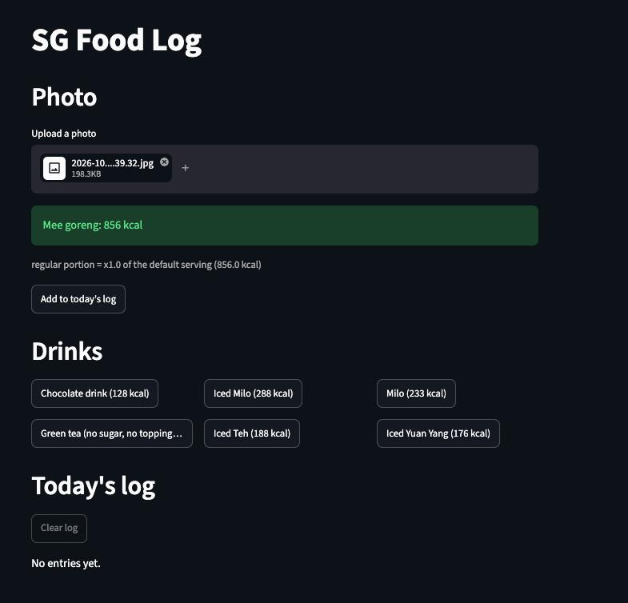

# sg-food-mcp

Look up the calories in Singapore hawker food using the Health Promotion
Board's own figures, so an AI assistant answers from the official database
instead of guessing from memory.

**Status: built and evaluated.** Lookup, photo estimation, and a small logging
app all work. There's no live demo link — see [Decisions](#decisions-and-tradeoffs)
for why.

## The problem

Ask any AI assistant how many calories are in a plate of chicken rice and it
will give you a confident number from memory. It has no idea which of the six
kinds of chicken rice you meant, and no source for the figure it quotes.

Singapore has an official answer: HPB's Food Insights Database. This project
puts that database behind an AI assistant, so the assistant identifies the
dish and the database supplies the number. The model never states a calorie
figure of its own.

## The case that shaped the design

The database has 16 kopi variants. These five are all served in the same
400ml cup, and they are indistinguishable in a photograph:

| Drink | kcal per 400ml cup |
|---|---|
| Iced Kopi O kosong (no milk, no sugar) | 40 |
| Iced Kopi O siu dai (no milk, less sugar) | 88 |
| Iced Kopi C (evaporated milk) | 160 |
| Iced Kopi siu dai (condensed milk, less sugar) | 188 |
| Iced Kopi (condensed milk) | 240 |

Six times the calories, same photo. Across all 16 kopi rows the spread runs
from 33 to 240 kcal.

**So drinks don't go through the camera.** They get a tap menu of your usual
orders instead. The data is finer-grained than any camera can resolve, and
pretending otherwise would have made the drinks answers confidently wrong.
Finding that out early removed the single largest source of error in the app
before it was built.

## Three other decisions

- **Per-serving figures only.** The source also carries per-100g values, and
  they're withheld from the assistant. A model can't estimate grams from a
  photo, so offering both creates a choice where the wrong pick is roughly
  3x off and looks exactly as confident as the right one.
- **All 1,163 rows kept.** Trimming the database to the dishes I actually eat
  was tempting and rejected: a missing dish is a worse failure than a noisy
  search result, and the hand-written columns scale with my diet anyway, not
  with the size of the file.
- **No invented ranges.** Only 16% of rows describe a larger portion, and the
  source gives no calorie figure for it. Rather than derive one, the app will
  ask the user "regular or large?" and say which answer it used.

The full log, including the decisions that were reversed, is in
[DECISIONS.md](DECISIONS.md).

## What works today


- **1,163 dishes and drinks** from HPB, normalised into one table, with
  per-serving calories, protein, carbs and fat.
- **Search that matches how people actually type.** "kopi peng" and "cai fan"
  appear nowhere in the official data, so 30 rows carry hand-written aliases.
  Typing `kopi peng` returns Iced Kopi first.
- **Portion descriptions for the 22 dishes I eat most**, in plain language
  ("standard hawker plate, 1 bowl of rice"), written against the serving size
  HPB actually weighed.
- **A working connection to Claude.** Ask "how many calories in kopi peng?"
  and it searches the database and answers 240 kcal, citing the serving size.
- **Per-piece items handled.** Satay is 57 kcal per stick, so ten sticks is
  570. The database figure is per stick, and the assistant is told to multiply.
- **A photo estimator** (`src/vision.py`, `src/estimate.py`): name the dish
  from a photo, then take the kcal from the database — never from the vision
  model. Below a 0.6 confidence threshold it asks a question instead of
  guessing a number. Drinks skip the camera entirely (see the kopi case
  above) and go through the same tap list as the app.
- **A Streamlit logging app** (`app.py`): upload a photo to estimate a meal,
  tap a favourite drink, see today's running total. Logging is session-only:
  it isn't saved to a database, so it disappears once the session ends.


- **An eval harness** (`evals/run.py`) that scores each vision backend
  against a 23-photo labelled set — see [Results](#results) below.

## Results

Scored on 23 labelled hawker photos, both backends run against the same set
(`evals/run.py --backend gemini|ollama`, full numbers in
[evals/results.md](evals/results.md)):

| Backend | Dish correct | Kcal within ±20% | Median latency | Cost/photo | Refusal rate |
| --- | --- | --- | --- | --- | --- |
| Gemini | 13.0% (3/23) | 39.1% (9/23) | 1.73s | $0.00 | 0.0% (0/23) |
| Ollama | 0.0% (0/23) | 21.7% (5/23) | 16.71s | $0.00 | 0.0% (0/23) |

Gemini wins on both speed and accuracy, at the same $0 cost (free tier on
both sides), so it's the default backend.

Dish-correct is low on both, and it's the data, not the pipeline: several
eval photos show dishes the 1,163-row HPB set has no entry for. The vision
model still names something, `search()` still fuzzy-matches it to the
nearest dish in the database, and that dish's kcal sometimes lands within
±20% by luck while the name is wrong. Zero refusals across both backends
confirms the estimator never says "I don't know this dish" — it always
returns a nearest match or a portion question, never a blank. A bigger or
user-extensible database would move dish-correct more than any change to
the vision side. Not fixed here; flagged for whoever picks up data coverage
next.

## Decisions and tradeoffs

The case above (kopi) and the three decisions below shaped the lookup half.
Building the estimator and app added a few more with real consequences:

- **No live deploy link.** The spec's own rule: ship a link only once abuse
  is handled (a per-session call limit or an access code). Neither is built,
  so this repo ships as code + walkthrough instead of a hosted demo.
- **A confidence threshold, not a best guess.** Below 0.6, `estimate()`
  returns a question ("regular or large?") instead of a kcal number. A wrong
  number that looks exact is worse than an honest question.
- **Portion multipliers are assumptions, not measurements.** Small/regular/
  large map to ×0.75/×1.0/×1.4 of the default serving — picked before
  evaluation, tested by the eval above, not tuned after seeing results.
- **One `search()`/`lookup()` implementation, two callers.** The MCP server
  and the estimator both call the same plain functions in `src/data.py`
  directly — no second copy of the matching logic to drift out of sync.
- **Free backends only.** Gemini (hosted, free tier) and Ollama (local,
  open-weight) behind one interface in `src/vision.py`, chosen by
  `VISION_BACKEND` in `.env`. No paid API, so the eval's $0.00/photo is
  literal, not rounded.

The full log — including decisions that were reversed — is in
[DECISIONS.md](DECISIONS.md).

## What's next

1. **A bigger or user-extensible dish database.** The single largest lever
   on dish-correct accuracy, per the eval above — not a vision-side fix.
2. **Tighter fuzzy matching.** Visible in the screenshot above: searching
   "kopi peng" also returns "Ham chim peng with red bean" because the name
   contains "peng". The real match still ranks first, so it's noise rather
   than a wrong answer, but it should be tightened.
3. **Abuse handling**, if a live deploy ever happens — a per-session call
   limit or an access code, per the spec.

## Run it

Needs Python 3.12.

```bash
git clone https://github.com/zienxu/sg-food-mcp.git
cd sg-food-mcp
python3 -m venv .venv && .venv/bin/pip install -r requirements.txt
.venv/bin/python scripts/smoke_test.py          # should print "smoke test passed"
```

To use it from an AI assistant, point an MCP client at `.mcp.json`; to poke
the tools directly in a browser:

```bash
npx @modelcontextprotocol/inspector .venv/bin/python src/server.py
```


To run the photo estimator or the app, add a `.env` with `VISION_BACKEND`
(`gemini` or `ollama`) and either `GEMINI_API_KEY` + `GEMINI_MODEL`, or
`OLLAMA_MODEL` for a local model. Then:

```bash
.venv/bin/streamlit run app.py                              # the logging app
.venv/bin/python evals/run.py --backend gemini|ollama        # score a backend
```

## Data and licence

Singapore Food Insights Database, Health Promotion Board, via a
[CC0 mirror on Kaggle](https://www.kaggle.com/datasets/adisongoh/singapore-hawker-food-nutritional-information)
uploaded by Adison Goh. The CSV is committed to this repo so it runs with no
download step. Nutrition figures are HPB's; the aliases, portion
descriptions and code are mine.
